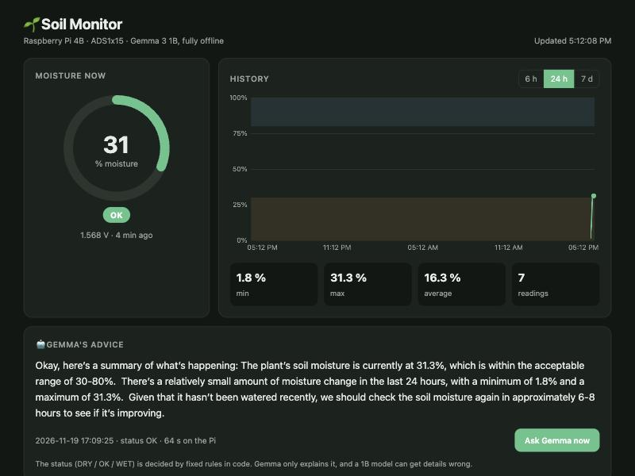
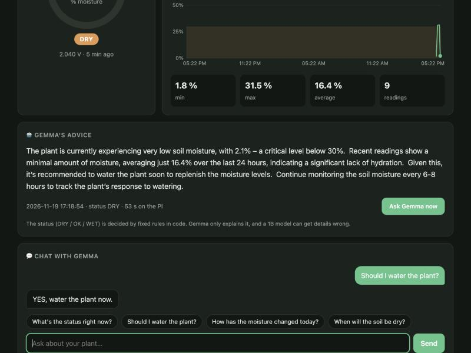
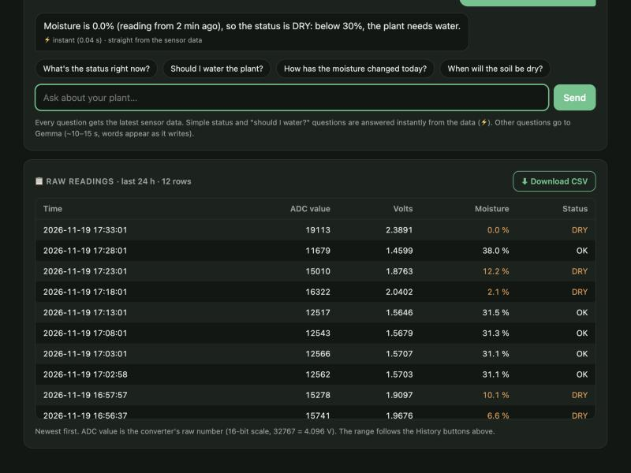

# Offline AI Soil Moisture Monitor — Raspberry Pi 4B + Gemma

A full step-by-step build log of this project. Each part records what we did, the exact commands, and the real results we got, so you can follow along and build it yourself.

---

## Project at a glance

| Item | Details |
|---|---|
| Board | Raspberry Pi 4B, 4 GB RAM |
| OS | Ubuntu 22.04.5 LTS (aarch64) |
| AI runtime | Ollama 0.40.16 |
| AI model | `gemma3:1b` (runs fully offline) |
| Sensor | Capacitive soil moisture sensor (analog) |
| ADC | ADS1115 / ADS1015 I2C module (purple, 10-pin) |
| Language | Python 3 |
| Storage | SQLite |

**Idea:** the Pi reads soil moisture through an ADC, stores the readings, and a local AI model (Gemma, no internet) turns the numbers into a plain-English summary and advice.

---

## Part 1 — Running an offline AI model on the Pi  ✅ Done

### 1.1 Check the Pi can handle it

Command (run on the Mac, connects over SSH):

```bash
ssh -t <user>@<pi-ip> 'uname -m; lsb_release -ds; free -h; swapon --show; df -h /; ollama --version; ollama list; systemctl is-active ollama; vcgencmd measure_temp'
```

Results:

| Check | Result | Meaning |
|---|---|---|
| CPU | `aarch64` | 64-bit ARM, supported by Ollama |
| OS | Ubuntu 22.04.5 LTS | OK |
| RAM | 3.7 GiB total, **1.8 GiB available** | The real limit for model size |
| Swap | 1 GiB swap file | Small safety buffer |
| Disk | 41 GB free | Plenty |
| Ollama | 0.40.16, service `active`, no models yet | Ready |
| Temperature | 54 °C | OK; use a heatsink/fan for long runs |

### 1.2 Which model fits in 4 GB?

| Model | Download | RAM while running | Verdict |
|---|---|---|---|
| `gemma3:270m` | ~0.3 GB | < 1 GB | Fits, very fast, weak answers |
| **`gemma3:1b`** | ~0.8 GB | ~1.2–1.5 GB | **Fits — chosen** |
| `gemma3:4b` | ~3.3 GB | ~4 GB+ | Too big — swaps heavily or crashes |

### 1.3 Download and test Gemma

```bash
ssh -t <user>@<pi-ip> 'ollama pull gemma3:1b && ollama run gemma3:1b --verbose "In two sentences, what is a Raspberry Pi?"; free -h; ollama ps'
```

Gemma's answer (offline, on the Pi):

> A Raspberry Pi is a small, affordable, and versatile single-board computer that can be used for a wide range of projects, from simple automation to more complex applications like media centers. It's powered by an operating system like Linux, making it ideal for hobbyists, makers, and students alike.

Performance:

| Metric | Value |
|---|---|
| Model size loaded | 883 MB, 100% CPU |
| Load time (cold start) | 14.7 s |
| Prompt reading speed | 9.9 tokens/s |
| **Answer generation speed** | **2.6 tokens/s** (~2 words/s) |
| Free RAM with model loaded | 1.0 GiB (277 MB swap used) |

### 1.4 Chatting with Gemma

Ollama is installed on the **Pi**, not the laptop — so connect first:

```bash
ssh -t <user>@<pi-ip> ollama run gemma3:1b
```

Type at the `>>>` prompt, `/bye` to exit.

> 🎬 **Tutorial tip:** running `ollama run` on the laptop gives `command not found: ollama` — a good moment to explain that the AI lives on the Pi.

---

## Part 2 — Project architecture

```
 Soil sensor ──analog──▶ ADS1115/ADS1015 ──I2C (GPIO2/3)──▶ Raspberry Pi 4B
                                                              │
        ┌─────────────────────────────────────────────────────┤
        ▼                        ▼                            ▼
 1. Collector (Python)    2. Storage (SQLite)          3. Analyzer (Python)
 reads every 5 min  ───▶  timestamp, raw, %    ───▶   every few hours:
 converts raw → %                                     builds stats → asks
 checks thresholds                                    Gemma via Ollama API
        │                                                     │
        └──────────────▶ 4. Output: alerts, log, web dashboard (optional)
```

| Layer | Job | Tools |
|---|---|---|
| Sensor | Measures soil moisture as a voltage | Capacitive soil moisture sensor v1.2 |
| ADC | Converts voltage → number (Pi has no analog pins) | ADS1115/ADS1015 over I2C |
| Collector | Reads, averages, converts to % | Python + `adafruit-circuitpython-ads1x15`, systemd service |
| Storage | Keeps history | SQLite |
| Analyzer | Plain-English insight | Python → `http://localhost:11434/api/generate` → `gemma3:1b` |
| Output | Show results | Terminal/log → Flask web page / Telegram (later) |

### Design rules

1. **Don't send raw data to the AI.** Gemma writes ~2.6 tokens/s with ~1 GB RAM spare. Python computes a short summary (current %, change over 24 h, rate, min/max) and Gemma interprets it. A ~100-token reply ≈ 40 s.
2. **Code decides, AI explains.** Thresholds like `moisture < 30% → alert` live in Python. A 1B model can get numbers wrong, so it only writes the explanation and suggestions.
3. Let Ollama unload the model between runs so RAM stays free for everything else.

---

## Part 3 — Hardware

### 3.1 Parts list

| Part | Qty | Notes |
|---|---|---|
| Raspberry Pi 4B (4 GB) | 1 | Already set up |
| ADS1115/ADS1015 module | 1 | ✅ Have it |
| Capacitive soil moisture sensor v1.2 | 1 | Prefer over the 2-prong resistive type (corrodes) |
| Female–female jumper wires | ~8 | |
| Relay module + 5 V pump | optional | For auto-watering later |

### 3.2 The ADC module

Pins (left to right): **V, G, SCL, SDA, ADDR, ALERT, A0, A1, A2, A3**

| Pin | Purpose |
|---|---|
| V | Power, use 3.3 V |
| G | Ground |
| SCL / SDA | I2C clock / data |
| ADDR | Sets the I2C address (GND → `0x48`) |
| ALERT | Optional comparator/ready output (not used) |
| A0–A3 | 4 analog inputs → up to 4 sensors |

> ⚠️ **Check which chip you have.** The board is sold as "ADS1115/ADS1015". Read the tiny marking on the chip:
> - `BOGI` → **ADS1115** (16-bit)
> - `BRPI` → **ADS1015** (12-bit)
>
> Both work for soil moisture (12-bit is plenty). Same wiring, same address — only the Python class differs (`ADS1115` vs `ADS1015`).

### 3.3 Wiring

| ADC pin | Connects to | Pi physical pin |
|---|---|---|
| V | 3.3 V | Pin 1 |
| G | GND | Pin 6 |
| SCL | GPIO3 (SCL) | Pin 5 |
| SDA | GPIO2 (SDA) | Pin 3 |
| ADDR | GND | Pin 9 (or any GND) |
| A0 | Sensor **AOUT** | — |

| Sensor pin | Connects to |
|---|---|
| VCC | 3.3 V (Pin 17) |
| GND | GND (Pin 14) |
| AOUT | ADC **A0** |

Power everything from **3.3 V** so no signal can exceed what the Pi's I2C pins tolerate.

### 3.4 Enable I2C and detect the module  ✅ Done

One command does it all (enter your password for SSH, then for `sudo`):

```bash
ssh -t <user>@<pi-ip> 'grep -n "i2c" /boot/firmware/config.txt; grep -q "^dtparam=i2c_arm=on" /boot/firmware/config.txt && echo I2C_ALREADY_ON || echo "dtparam=i2c_arm=on" | sudo tee -a /boot/firmware/config.txt; sudo apt-get install -y i2c-tools; ls -l /dev/i2c-*; sudo i2cdetect -y 1'
```

What happened:
- `/boot/firmware/config.txt` line 15 already had `dtparam=i2c_arm=on`, so **no reboot was needed** (Ubuntu for Pi enables I2C by default).
- `i2c-tools` installed (102 kB).
- `/dev/i2c-1` exists. It is owned by group `dialout`, so a normal user needs to be in that group to read it without `sudo`.

Scan result: the module answers at **0x48**:

```
     0  1  2  3  4  5  6  7  8  9  a  b  c  d  e  f
40: -- -- -- -- -- -- -- -- 48 -- -- -- -- -- -- --
```

> 🎬 **Tutorial tip:** the `48` popping up in the `i2cdetect` grid is the "it's alive" moment: the Pi can see the ADC. If you see only `--`, check SDA/SCL aren't swapped and V/G are powered.

---

## Part 4 — Build steps (checklist)

**Phase 1 — Hardware** ✅ Done
- [x] Wire the ADC and sensor as in Part 3.3
- [x] Enable I2C: `dtparam=i2c_arm=on` in `/boot/firmware/config.txt` (already on by default in Ubuntu — line 15)
- [x] Install tools: `sudo apt install -y i2c-tools`
- [x] `sudo i2cdetect -y 1` shows **48**

**Phase 2 — Reading data** (see Part 5)
- [x] Install `python3-smbus` (apt), add user to `dialout`
- [x] `sensor.py` prints live voltage: steady **1.411 V**
- [x] Calibrate: dry air **2.074 V (0%)**, water **0.457 V (100%)**

**Phase 3 — Collector + storage** ✅ Done (see Part 6)
- [x] Collector: read every 5 min, average 10 samples, save to SQLite
- [x] systemd service: starts on boot, restarts on crash

**Phase 4 — AI analysis** ✅ Done (see Part 7)
- [x] Analyzer: last 24 h stats → prompt → Gemma → save reply
- [x] systemd timer: every 6 h, plus immediate run when a threshold is crossed

**Phase 5 — Output** ✅ Dashboard done (see Part 8)
- [x] Web dashboard: moisture chart + latest Gemma summary (standard library instead of Flask)
- [ ] Relay + pump for auto-watering

---

## Part 5 — Reading the sensor in Python

### 5.1 The scripts (in `pi/`, copied to `~/soil-monitor` on the Pi)

| File | What it does |
|---|---|
| [`sensor.py`](pi/sensor.py) | Talks to the ADC over I2C, averages 10 samples, prints volts (and % once calibrated). `python3 sensor.py --count 10` |
| [`calibrate.py`](pi/calibrate.py) | Guided 2-point calibration: dry air = 0 %, water = 100 %. Saves `calibration.json` |

How `sensor.py` reads the ADC (good to explain on camera):
1. Write a 16-bit **config word** (`0xC383` for A0) to register `0x01`: "measure A0 vs GND, ±4.096 V range, one single reading".
2. Poll the config register until bit 15 says the conversion is finished.
3. Read 2 bytes from register `0x00` → signed number → `volts = raw × 4.096 / 32768`.

This works for **both ADS1115 and ADS1015** unchanged: the ADS1015 puts its 12-bit result in the same 16-bit slot, so the volts math is identical.

Moisture % (capacitive sensors read **higher when dry**):

```
moisture % = (dry_volts − volts) / (dry_volts − wet_volts) × 100
```

Only one library is needed, from Ubuntu's own packages:

```bash
sudo apt-get install -y python3-smbus
```

### 5.2 Setting up SSH key login (no more passwords)

Every step was typing the Pi password, and if you take longer than ~2 minutes the Pi hangs up with `Connection closed by <ip> port 22` (the SSH login timeout). Fix it once:

```bash
ssh-keygen -t ed25519 -C "mac-to-raspberry-pi"          # on the Mac
ssh-copy-id -i ~/.ssh/id_ed25519.pub <user>@<pi-ip>     # enter Pi password one last time
ssh <user>@<pi-ip> 'echo KEY_LOGIN_OK'                  # no password asked
```

`sudo` on the Pi still asks for the password; keys only replace the login password.

Copy files to the Pi with `scp -O` (older copy mode):

```bash
scp -O -r pi <user>@<pi-ip>:soil-monitor
```

### 5.3 Problems we hit (and fixes)

| Error | Cause | Fix |
|---|---|---|
| `Connection closed by … port 22` | Password typed after the ~2 min login timeout | Type faster, or use SSH keys (5.2) |
| `PermissionError: [Errno 13] Permission denied` on `SMBus(1)` | `/dev/i2c-1` belongs to group `dialout`; user wasn't in it | `sudo usermod -aG dialout <user>`, then log in again |
| `AttributeError: __enter__` | Ubuntu's `python3-smbus` doesn't support `with SMBus(...)` | `with closing(SMBus(1)) as bus:` (from `contextlib`) |

> 🎬 **Tutorial tip:** these three errors are very common for beginners. Showing them and the fix makes the video more useful than a perfect run.

### 5.4 First live reading

```
$ python3 sensor.py --count 10 --interval 0.5
Not calibrated yet: showing volts only (run calibrate.py).
A0: 1.411 V
A0: 1.411 V
A0: 1.410 V
...
```

Rock-steady (±1 mV), so the sensor is connected and the averaging works. A floating, unconnected input would jump around.

### 5.5 Calibration  ✅ Done

```bash
ssh -t <user>@<pi-ip> 'cd ~/soil-monitor && python3 calibrate.py'
```

Hold the sensor in dry air → Enter; then dip it in water up to the white line → Enter.

```
STEP 1: Wipe the sensor and hold it in DRY AIR.
Measuring for 5 seconds...
  2.073 V
  2.074 V ...
Average: 2.074 V

STEP 2: Put the sensor in a glass of WATER (only up to the white line).
Measuring for 5 seconds...
  0.458 V
  0.459 V ...
Average: 0.457 V

Saved to /home/shivansh/soil-monitor/calibration.json
  0 %   (dry)  = 2.074 V
  100 % (water)= 0.457 V
```

Saved `calibration.json`:

```json
{ "dry_volts": 2.0736, "wet_volts": 0.4567, "channel": 0, "date": "2026-11-19 16:54" }
```

This sensor's range is **2.07 V → 0.46 V** (a 1.6 V swing), which is lower than the 2.5–2.8 V "dry" figure often quoted, because it runs on 3.3 V. That's why calibrating your own sensor matters.

### 5.6 Live moisture %

```
$ python3 sensor.py --count 5 --interval 0.5
A0: 1.862 V   moisture:  13.1 %
A0: 1.862 V   moisture:  13.1 %
...
```

Right after coming out of the water the sensor was still slightly damp, so it showed ~13 % instead of 0 %. The very first reading (1.411 V) works out to ~41 %.

> 🎬 **Tutorial tip:** run `python3 sensor.py` live, then push the sensor into dry soil, water it, and watch the % climb in real time.

---

## Part 6 — Logging readings 24/7  ✅ Done

### 6.1 The files

| File | What it does |
|---|---|
| [`collector.py`](pi/collector.py) | Every 5 min: average 10 samples → convert to % → save a row in SQLite. A failed read is logged, not fatal. |
| [`show_data.py`](pi/show_data.py) | Prints the latest rows + a 24 h min / max / average. `python3 show_data.py -n 50` |
| [`soil-collector.service`](pi/soil-collector.service) | systemd unit: starts at boot, restarts 10 s after any crash |

Database: `~/soil-monitor/data/moisture.db`, table `readings`:

| Column | Type | Example |
|---|---|---|
| `id` | integer | 4 |
| `ts` | Unix seconds (for maths) | seconds since 1970 |
| `time` | local time (for humans) | `2026-11-19 16:57:57` |
| `channel` | ADC input | 0 |
| `volts` | real | 1.910 |
| `percent` | real (NULL if uncalibrated) | 10.1 |

SQLite was chosen because it's a single file, needs no database server, and Python has it built in.

### 6.2 Test it by hand first

```bash
cd ~/soil-monitor
python3 collector.py --interval 5 --count 3     # 3 readings, 5 s apart
python3 show_data.py
```

```
Logging A0 every 5 s to /home/shivansh/soil-monitor/data/moisture.db
16:56:27  2.041 V  2.0 %
16:56:32  2.044 V  1.8 %
16:56:37  1.968 V  6.6 %
```

### 6.3 Run it as a service

```bash
sudo cp ~/soil-monitor/soil-collector.service /etc/systemd/system/
sudo systemctl daemon-reload
sudo systemctl enable --now soil-collector     # start now + on every boot
```

Check it:

```bash
systemctl status soil-collector                 # should say active (running)
journalctl -u soil-collector -f                 # live log, Ctrl-C to exit
python3 ~/soil-monitor/show_data.py             # what's been saved
```

Result:

```
enabled
active
Started Soil moisture collector (ADS1x15 -> SQLite).
Logging A0 every 300 s to /home/shivansh/soil-monitor/data/moisture.db
16:57:58  1.910 V  10.1 %
```

Useful commands: `sudo systemctl stop soil-collector` / `restart` / `disable`.

> 🎬 **Tutorial tip:** reboot the Pi on camera (`sudo reboot`), then show `systemctl status soil-collector` coming back up on its own: proof it runs unattended.

---

## Part 7 — AI analysis with Gemma  ✅ Done

### 7.1 How it works: code decides, AI explains

```
SQLite readings ──▶ analyzer.py computes stats ──▶ rules set status (DRY/OK/WET)
                                                         │
                         short text summary ◀────────────┘
                                │
                                ▼
          Ollama API (localhost:11434) ──▶ gemma3:1b ──▶ plain-English advice
                                                              │
                                     saved in `analyses` table ◀┘
```

| Rule (in `analyzer.py`) | Value |
|---|---|
| DRY (needs water) | below **30 %** |
| WET (risk of root rot) | above **80 %** |
| "Watered" detection | jump of **15 %+** between two readings |
| Trend window | last **3 h** (needs ≥ 3 readings over ≥ 30 min) |

Stats sent to Gemma: current %, 24 h min / max / average, trend (% per hour, least-squares fit), hours until dry, hours since watering. **Never raw data.**

Ollama is called with plain Python (`urllib`, no extra libraries):

```python
{"model": "gemma3:1b", "prompt": prompt, "stream": False,
 "keep_alive": "1m",                          # unload soon → RAM back
 "options": {"temperature": 0.3, "num_predict": 150}}
```

### 7.2 Files

| File | What it does |
|---|---|
| [`analyzer.py`](pi/analyzer.py) | Stats + rules + Gemma → saves to `analyses` table. `--no-ai` = skip Gemma, `--show` = print latest |
| [`soil-analyzer.service`](pi/soil-analyzer.service) | Runs the analyzer once (oneshot), after Ollama is up |
| [`soil-analyzer.timer`](pi/soil-analyzer.timer) | Every 6 h (00:00, 06:00, 12:00, 18:00); catches up if the Pi was off |
| [`collector.py`](pi/collector.py) (updated) | When moisture **crosses** into DRY or WET, starts the analyzer immediately (max once per hour) |

### 7.3 First AI analysis (real output)

```bash
python3 ~/soil-monitor/analyzer.py
```

```
Status (decided by code): DRY
{ "current_percent": 10.1, "readings_24h": 4, "min_24h": 1.8,
  "max_24h": 10.1, "avg_24h": 5.1, "trend_percent_per_hour": null, ... }

Prompt sent to Gemma:
You are a friendly garden assistant. A sensor measures the soil moisture of a potted plant. Here is the summary:
- Current soil moisture: 10.1 %
- Status: DRY - below 30 %, the plant needs water
- Last 24 hours: min 1.8 %, max 10.1 %, average 5.1 % (4 readings over 0.0 hours)
- Trend: not enough data yet

In 3 short sentences: explain what this means, say what to do now, and say when to check again. ...

Gemma's advice (58 s):
The soil moisture is currently 10.1%, which is significantly below the recommended 30% level
for the plant. We've seen a recent decrease in moisture, with the last 24 hours showing a minimum
of 1.8% and an average of 5.1%. Therefore, it's time to water the plant soon to prevent it from
drying out. Continue monitoring the soil moisture every 24 hours to track the plant's hydration level.
```

RAM during the run: **1.0 GiB still available**. Time: **58 s**.

> ⚠️ **Gemma made a mistake:** it says moisture *decreased*, but it actually went **up** (1.8 % → 10.1 %). This is exactly why the code makes the decision (DRY → water it) and the 1B model only explains.
>
> 🎬 **Tutorial tip:** show this on camera. It's an honest, memorable lesson about small offline models.

### 7.4 Testing the alert trigger (simulation on the Mac)

Fake voltages fed into `collector.py` → `OK, OK, DRY, DRY, WET, DRY`:

```
66.4 %  54.0 %  23.1 %  16.9 %  100.0 %  16.9 %
TRIGGERS: ['status OK -> DRY']
```

It fired **once** on OK → DRY; the later WET crossing was blocked by the 1-hour cooldown (stops sensor noise around 30 % from running Gemma over and over).

### 7.5 Install the timer

```bash
sudo cp ~/soil-monitor/soil-analyzer.service ~/soil-monitor/soil-analyzer.timer /etc/systemd/system/
sudo systemctl daemon-reload
sudo systemctl enable --now soil-analyzer.timer
sudo systemctl restart soil-collector          # load the new trigger code
```

Check:

```bash
systemctl list-timers soil-analyzer.timer
```

```
NEXT                        LEFT       UNIT                ACTIVATES
Thu 2026-11-19 18:00:00 IST 56min left soil-analyzer.timer soil-analyzer.service
```

Other useful commands:

```bash
sudo systemctl start soil-analyzer        # run an analysis right now
journalctl -u soil-analyzer -n 30         # see the last analysis log
python3 ~/soil-monitor/analyzer.py --show # latest saved advice
```

---

## Part 8 — Web dashboard  ✅ Done



Open **http://10.30.0.183:8080** from any phone or laptop on the same Wi-Fi.

### 8.1 Files

| File | What it does |
|---|---|
| [`dashboard.py`](pi/dashboard.py) | Web server using only Python's standard library: no Flask, nothing to install |
| [`web/index.html`](pi/web/index.html) | The page. No CDN or internet: the chart is drawn by hand on a `<canvas>` |
| [`soil-dashboard.service`](pi/soil-dashboard.service) | Starts the dashboard on boot, restarts on crash |

API (handy to show with `curl`):

| Endpoint | Returns |
|---|---|
| `GET /api/latest` | Latest reading + status + latest Gemma analysis |
| `GET /api/readings?hours=24` | Readings for the chart |
| `POST /api/analyze` | Runs `analyzer.py` now (won't start a second run while one is going) |

Page features: gauge coloured by status, history chart (6 h / 24 h / 7 d) with the DRY and WET zones shaded, min / max / average, Gemma's advice with an **Ask Gemma now** button (spinner while it thinks), auto light / dark mode, phone layout, auto-refresh every 60 s.

### 8.2 Install

```bash
scp -O -r pi/dashboard.py pi/soil-dashboard.service pi/web <user>@<pi-ip>:soil-monitor/
sudo cp ~/soil-monitor/soil-dashboard.service /etc/systemd/system/
sudo systemctl daemon-reload
sudo systemctl enable --now soil-dashboard
```

```
$ systemctl is-active soil-dashboard soil-collector soil-analyzer.timer
active
active
active
```

### 8.3 "Ask Gemma now" test (real result)

The reading rose from ~10 % to 31 %, the analyzer correctly detected a watering, and Gemma replied in **64 s**:

```json
{ "current_percent": 31.3, "min_24h": 1.8, "max_24h": 31.3, "avg_24h": 16.3,
  "last_watered_hours_ago": 0.1, "status": "OK" }
```

> Okay, here's a summary of what's happening: The plant's soil moisture is currently at 31.3%, which is within the acceptable range of 30-80%. There's a relatively small amount of moisture change in the last 24 hours, with a minimum of 1.8% and a maximum of 31.3%. Given that it hasn't been watered recently, we should check the soil moisture again in approximately 6-8 hours to see if it's improving.

⚠️ Two more mistakes from the 1B model: it calls a 1.8 → 31.3 % jump "small", and says "it hasn't been watered recently" although the data said watered 0.1 h ago. The status (OK) is right because code decided it.

> 🎬 **Tutorial tip:** open the dashboard on your phone, press **Ask Gemma now**, and show the spinner then the new advice, all with the Pi's Wi-Fi to the internet unplugged to prove it's offline.
>
> 🔒 There's no login: anyone on your Wi-Fi can view it and press the button. Fine at home; never port-forward 8080 to the internet.

### 8.4 Chat with Gemma on the dashboard



At the bottom of the dashboard there's a **💬 Chat with Gemma** box. Type a question, or tap a suggestion: *What's the status right now?*, *Should I water the plant?*, *How has the moisture changed today?*, *When will the soil be dry?*

How it works:

```
Browser ──POST /api/chat {question, last 3 Q&As}──▶ dashboard.py
   │                                                   │ 1. compute_stats() from SQLite (fresh every question)
   │                                                   │ 2. system prompt = live facts + rules
   │                                                   │ 3. Ollama /api/chat, stream=True
   ◀───────── answer streams back word by word ────────┘
```

- **Fresh data per question:** the facts are rebuilt from the database each time, so "right now" really means now.
- **Streaming:** Gemma writes ~2.6 tokens/s, so words appear as they're generated instead of after a long wait.
- **Follow-ups:** the browser sends the last 3 questions and answers back, so "why?" works.
- **One at a time:** a lock allows one answer at once (RAM); a second person gets "Gemma is busy".
- **Model stays loaded 5 min** after a question (`keep_alive: "5m"`) so follow-ups skip the ~15 s load.

API test from the Mac:

```bash
curl -N -X POST -H 'Content-Type: application/json' \
  -d '{"question":"What is the status right now?"}' http://10.30.0.183:8080/api/chat
```

```
The status is DRY – below 30 %.
```

**Gemma got it wrong at first, so code now gives it the answer.**

| Question | Moisture | Before the fix | After the fix |
|---|---|---|---|
| Should I water the plant? | 2.1 % (DRY) | ❌ "No, the soil moisture is currently 2.1%, which is below the 30% threshold." | ✅ "YES, water the plant now." |

The fix (in `summary_lines()` in `analyzer.py`): the code adds the decision as a fact, so the model only has to repeat it:

```python
action_text = {
    "DRY": "YES, water the plant now",
    "OK":  "NO, the plant does not need water right now",
    "WET": "NO, do not water; let the soil drain and dry out",
}[s["status"]]
lines.append(f"- Should it be watered? {action_text}")
```

The scheduled analyses use the same facts, so they got the fix too.

Timing: an answer takes **~25–40 s** on the Pi, mostly reading the ~250-token prompt (~10 tokens/s) before the first word appears.

Also seen during this test: the sensor dropped from 31.5 % to 2.1 % and the **DRY alert trigger fired on its own**, starting an analysis at 17:18:54 (53 s) without anyone pressing a button.

> 🎬 **Tutorial tip:** the "No" → "YES" fix is a great teaching moment: small models are bad at reasoning from numbers, so make the code do the reasoning and let the model do the talking.

### 8.5 Making the chat faster

**Measured first:** where do the ~30 s go?

| Step | Time |
|---|---|
| Read SQLite + build prompt | **0.09 s** |
| Gemma *reads* the prompt (268 tokens @ ~12 tok/s) | **22 s** ← the bottleneck |
| Gemma *writes* the answer (10–30 tokens @ ~3 tok/s) | 3–10 s |

So the data was never slow; the Pi's CPU reading a long prompt was. Two fixes:

**1. Shorter prompt** (774 → 272 characters):

```
Potted plant soil monitor. Data: moisture 2.1% (3 min ago); status DRY (too dry); water now: YES;
24h min 1.8% max 31.5% avg 16.4%; trend unknown; watered 0.4h ago.
Answer in 1-3 short sentences using only this data. Never change the status or the water decision.
```

**2. Instant answers without AI** for questions with one exact answer. `instant_answer()` in `dashboard.py` matches *status / right now / how wet* and *should I water / need water* questions and answers from code. Anything with *why, when, today, trend, change…* still goes to Gemma.

Results:

| Question | Before | After | Answered by |
|---|---|---|---|
| What's the status right now? | 32 s | **0.09–0.13 s** | ⚡ code |
| Should I water the plant? | 25 s | **0.02 s** | ⚡ code |
| How has the moisture changed today? | ~30 s | **14–15 s** | 🤖 Gemma |
| When will the soil be dry? | ~30 s | **22–26 s** | 🤖 Gemma |

Each chat bubble now shows its source: *⚡ instant · straight from the sensor data* or *🤖 Gemma · answered in N s*.

⚠️ **A short prompt can confuse a small model.** The first short version wrote `status OK (DRY<30%, WET>80%)` and Gemma answered *"The soil is currently DRY (38.0%)"*: it read the word DRY in the rule. Writing `status OK (healthy)` fixed it. Gemma still struggles with trend questions when the readings jump around (here 2 % → 12 % → 38 % → 0 % in 20 minutes as the sensor was moved), so trust the numbers on the dashboard over its wording.

> 🎬 **Tutorial tip:** ask the same question before and after on camera: 30 s vs 0.05 s. Then explain "measure first": the slow part wasn't where you'd guess.

### 8.6 Raw readings + CSV download



At the bottom of the dashboard: a **📋 Raw readings** table (newest first, follows the 6 h / 24 h / 7 d buttons) and a **⬇ Download CSV** button.

| Column | Meaning |
|---|---|
| Time | When the collector took the reading |
| ADC value | The converter's raw number, 16-bit scale (32767 = 4.096 V). Calculated back from volts: `volts × 32768 / 4.096` |
| Volts | Averaged sensor voltage |
| Moisture | Calibrated % |
| Status | DRY / OK / WET from the rules |

From the command line:

```bash
curl -o readings.csv "http://10.30.0.183:8080/api/readings.csv?hours=24"
curl "http://10.30.0.183:8080/api/readings?hours=6"          # JSON
```

```
time,unix_ts,adc_raw,volts,moisture_percent
2026-11-19 17:23:01,1795089181,15010,1.8763,12.2
2026-11-19 17:28:01,1795089481,11679,1.4599,38.0
2026-11-19 17:33:01,1795089781,19113,2.3891,0.0
```

The CSV opens straight in Excel / Google Sheets for your own charts.

Restarting the dashboard after a code change, without `sudo` (systemd brings it back in 5 s because of `Restart=always`):

```bash
kill $(systemctl show -p MainPID --value soil-dashboard)
```

(Don't use `pkill -f dashboard.py` over SSH: it also matches and kills your own SSH command.)

---

## Part 9 — The finished system

| Service | Job | Schedule |
|---|---|---|
| `soil-collector` | Read sensor → SQLite | every 5 min, 24/7 |
| `soil-analyzer.timer` | Stats + rules + Gemma advice | every 6 h, and on DRY/WET crossing |
| `soil-dashboard` | Web page on port 8080 | always on |

All three start on boot. Everything runs on the Pi with no internet.

**Ideas for a follow-up video:** relay + 5 V pump for auto-watering when DRY, Telegram alerts, more sensors on A1–A3, trying `gemma3:270m` vs `1b` for speed vs quality, a better prompt so the model makes fewer mistakes.

---

## Progress log

| Date | What happened |
|---|---|
| 2026-11-19 | Checked Pi resources; chose `gemma3:1b`; downloaded and tested it offline (2.6 tokens/s). |
| 2026-11-19 | Designed project architecture; identified ADS1115/ADS1015 module as the ADC. |
| 2026-11-19 | Wired ADC + sensor; I2C was already enabled; installed i2c-tools; module detected at 0x48. |
| 2026-11-19 | Wrote `sensor.py` + `calibrate.py`; set up SSH key login; fixed dialout permission and smbus `with` error; first live reading 1.411 V. |
| 2026-11-19 | Calibrated: dry 2.074 V = 0 %, water 0.457 V = 100 %. Live readout shows moisture % (13.1 % right after calibration). Phase 2 done. |
| 2026-11-19 | Phase 3: `collector.py` logs to SQLite every 5 min; installed `soil-collector` systemd service (enabled, active). |
| 2026-11-19 | Phase 4: `analyzer.py` (stats + rules + Gemma, 58 s per run); 6-hourly `soil-analyzer.timer` installed (next 18:00); collector triggers AI on DRY/WET crossing. |
| 2026-11-19 | Phase 5: web dashboard on port 8080 (`soil-dashboard` service); tested in the browser; "Ask Gemma now" ran in 64 s. Project complete. |
| 2026-11-19 | Added streaming chat with Gemma to the dashboard; fixed wrong "should I water?" answer by adding a code-decided action fact; DRY trigger confirmed working live. |
| 2026-11-19 | Chat speed-up: measured (22 of ~30 s = Gemma reading the prompt); shortened prompt 774 → 272 chars; instant code answers for status / watering (0.02–0.13 s); Gemma questions 14–26 s. Added raw readings table (ADC value, volts, %) and CSV download. |
