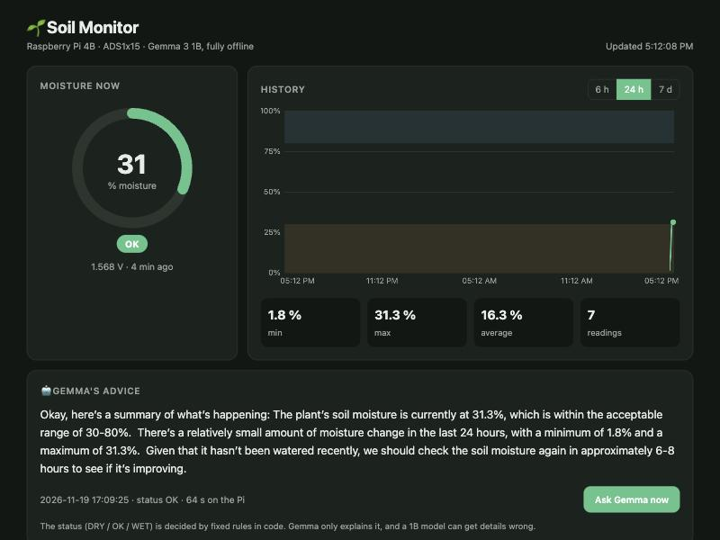
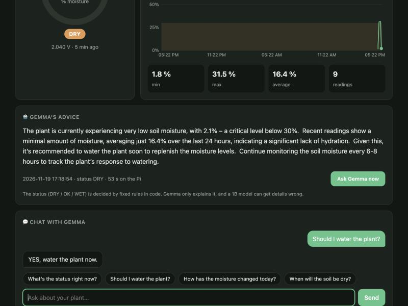
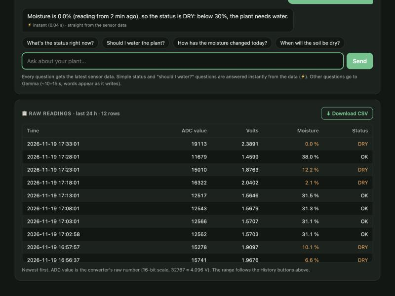

# Gemma on a Plant 🌱 — Offline AI Soil Moisture Monitor

A Raspberry Pi 4B (4 GB) reads a capacitive soil moisture sensor through an ADS1115/ADS1015 ADC, logs a reading every 5 minutes, and uses **Gemma 3 1B running locally with Ollama** to explain the plant's status in plain English. No cloud, no internet needed.



## Features

- Reads soil moisture over I2C every 5 minutes and saves it to SQLite
- Two-point calibration (dry / wet) turns volts into a 0–100 % moisture value
- **Code decides, AI explains:** the rules (DRY < 30 %, WET > 80 %, watering detected on a ≥ 15 % jump) are plain Python; Gemma turns the facts into advice
- AI analysis every 6 hours, plus right away when the soil turns DRY or WET
- Offline web dashboard (port 8080): gauge, 6 h / 24 h / 7 d chart, chat with Gemma, raw readings table, CSV download
- Everything runs as systemd services and starts on boot

| Chat with Gemma | Raw readings |
|---|---|
|  |  |

## Hardware

| Part | Notes |
|---|---|
| Raspberry Pi 4B, 4 GB | Ubuntu 22.04 (64-bit) |
| ADS1115 or ADS1015 module | I2C address `0x48` (ADDR → GND) |
| Capacitive soil moisture sensor v1.2 | Analog output |
| Jumper wires | |

**Wiring** (power everything from 3.3 V):

| From | To |
|---|---|
| ADC V | Pi 3.3 V (pin 1) |
| ADC G | Pi GND (pin 6) |
| ADC SCL | Pi GPIO3 / SCL (pin 5) |
| ADC SDA | Pi GPIO2 / SDA (pin 3) |
| ADC ADDR | GND |
| ADC A0 | Sensor AOUT |
| Sensor VCC / GND | Pi 3.3 V (pin 17) / GND (pin 14) |

## Setup

1. **Install Ollama and the model** (needs internet once):
   ```bash
   curl -fsSL https://ollama.com/install.sh | sh
   ollama pull gemma3:1b
   ```
2. **Enable I2C and install the tools:**
   ```bash
   echo "dtparam=i2c_arm=on" | sudo tee -a /boot/firmware/config.txt
   sudo apt-get install -y i2c-tools python3-smbus
   sudo usermod -aG dialout $USER     # access to /dev/i2c-1, then log in again
   sudo reboot
   sudo i2cdetect -y 1                # you should see 48
   ```
3. **Copy the code to the Pi:**
   ```bash
   scp -O -r pi <user>@<pi-ip>:~/soil-monitor
   ```
4. **Test and calibrate** (on the Pi):
   ```bash
   cd ~/soil-monitor
   python3 sensor.py          # live volts
   python3 calibrate.py       # sensor in dry air, then in water
   python3 sensor.py          # now shows moisture %
   ```
5. **Install the services.** The `.service` files use the user `shivansh`; change `User=` and the `/home/shivansh/...` paths to your own user first.
   ```bash
   sudo cp ~/soil-monitor/soil-*.service ~/soil-monitor/soil-analyzer.timer /etc/systemd/system/
   sudo systemctl daemon-reload
   sudo systemctl enable --now soil-collector soil-analyzer.timer soil-dashboard
   ```
6. Open **http://&lt;pi-ip&gt;:8080** from any device on the same Wi-Fi.

## Project files

| Path | What it is |
|---|---|
| `pi/sensor.py` | Reads the ADS1x15 over I2C, converts volts to % |
| `pi/calibrate.py` | Guided dry/wet calibration → `calibration.json` |
| `pi/collector.py` | Logs a reading every 5 min to `data/moisture.db` |
| `pi/show_data.py` | Prints the latest readings and 24 h stats |
| `pi/analyzer.py` | Computes stats and asks Gemma for a summary |
| `pi/dashboard.py`, `pi/web/index.html` | Web dashboard and chat |
| `pi/*.service`, `pi/*.timer` | systemd units |
| [BUILD_LOG.md](BUILD_LOG.md) | Full step-by-step build log with real results and fixes |

## Gemma on a Pi 4: what to expect

`gemma3:1b` (Q4_K_M, ~1 B parameters) uses about 0.9 GB of RAM. On a Pi 4 it writes about **2.6 tokens/s** and reads prompts at about 10–12 tokens/s, so a chat answer takes roughly 15–25 s. Simple questions like "Should I water?" are answered instantly by code.

---

Made by **ImpulseTech** for YouTube.
